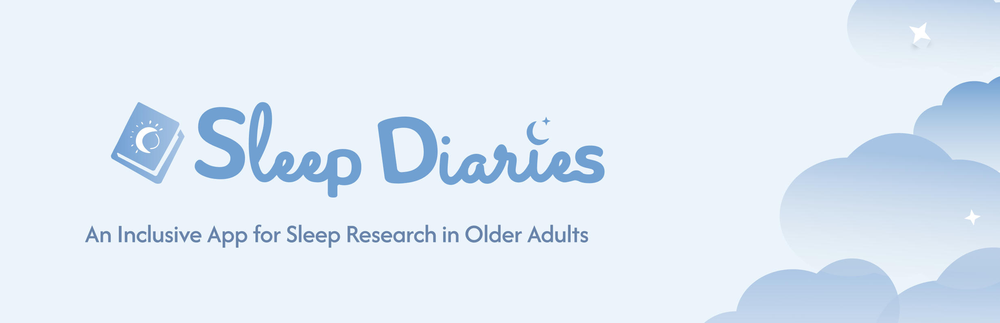

# 🌙 Sleep Diaries



An open-source, research-grade sleep diary app built with React Native and Expo. Available on **iOS**, **Android**, and the **web**. Designed to be easily tailored by researchers, clinicians, and developers for their own sleep studies and clinical needs.

[](https://github.com/circadia-bio/SleepDiaries/actions/workflows/test.yml)
[](https://github.com/circadia-bio/SleepDiaries/releases)
[](https://doi.org/10.5281/zenodo.19683378)
[](#)
[](https://expo.dev)
[](https://reactnative.dev)
[](https://react.dev)
[](https://sleepdiaries.circadia-lab.uk)
[](#)
[](./LICENSE)
[](https://github.com/circadia-bio/SleepDiaries/commits/main)
[](https://github.com/circadia-bio/SleepDiaries/issues)
[](https://github.com/circadia-bio/SleepDiaries/pulls)

🌐 **Web app:** https://sleepdiaries.circadia-lab.uk

> 🧬 **Adapting this for your own study?** Use [**SleepDiaries Protocol**](https://github.com/circadia-bio/SleepDiaries-Protocol) instead — a template repository that seeds a clean copy of a specific release with lab-specific config already stripped out.

---

## 📖 What is Sleep Diaries?

Sleep Diaries is a cross-platform app (iOS, Android, and web) that guides users through structured morning and evening questionnaires to track their sleep patterns over time. It is based on consensus sleep diary methodology used in clinical sleep research.

The app is intentionally simple and modular — the question sets, input types, themes, and data storage can all be customised without touching the core navigation or UI logic.

It also includes a suite of validated one-time research questionnaires (ESS, ISI, MEQ, PSQI, and others), a scored final report unlocking after 14 diary days, and support for researcher-assigned participant codes — making it suitable for deployment in structured sleep studies.

---

## ✨ Features

- 🌅 **Morning entry** — 13-question diary covering bedtime, sleep onset, night wakings, final awakening, sleep quality, and restedness
- 🌙 **Evening entry** — 5-question diary covering naps, caffeine, exercise, and medication
- ⏱️ **Rich input types** — 24-hour time stepper, duration stepper, yes/no, 1–5 rating scale, number counter, medication tracker, and free text
- 🔀 **Conditional questions** — follow-up questions appear automatically based on previous answers
- 🎨 **Dual themes** — amber for morning entries, blue for evening entries
- 💾 **Local persistence** — all entries saved to device storage via AsyncStorage
- 📋 **Past entries** — scrollable history grouped by date with expandable answer cards
- 📊 **Final report** — auto-unlocks after 14 morning entries, computes sleep metrics with colour-coded reference bands
- 🔭 **Sleep pattern actogram** — weekly chart of bedtime to out-of-bed time with night-waking markers and a sleep-midpoint trend line, so drifting schedules and missed days are visible at a glance
- 🕰️ **Chronotype band** — for participants who have completed the MCTQ, the actogram shades their chronotype and marks each night's sleep midpoint as inside or outside it; the band width is a setting, stored on the device only
- 🎯 **Age-aware reference ranges** — optional age group (under 18, 18–64, 65+) chosen at onboarding or in the Profile adjusts the green/amber/red bands for sleep duration, latency and WASO; stored on the device only
- 🛟 **Data-safety reminders** — entries live on the device, so the Home tab nudges participants to install the PWA (web) and to export a backup; the browser is also asked to keep storage persistent
- 📤 **Data export** — CSV and JSON export via native share sheet, including questionnaire results
- 🖼️ **Share card** — share a branded sleep report image to social media from the final report screen, with the original home screen background; works on iOS, Android, and mobile web (PWA)
- 🔔 **Push notifications** — daily 8am and 9pm reminders
- ⚙️ **Settings** — notifications toggle, text-to-speech, language, questionnaire credits, account management
- 👤 **Profile** — editable name and research code, summary stats, sleep metrics glossary, quick actions
- 📈 **Entry tab stats** — streak, entry counts, days in study
- 📥 **JSON import** — restore a backup or migrate between devices, with merge or replace (imports questionnaire results too)
- 📱 **iOS & Android** — single codebase via React Native + Expo
- 🌐 **Web** — Progressive Web App (PWA) installable on any device
- 📲 **Installable** — installs to home screen on iOS, Android, and desktop Chrome with full offline support
- 🌍 **Localisation** — English, Portuguese (Brazil) 🇧🇷 and Swedish 🇸🇪 (UI and daily diary), locale detected automatically from device settings
- 🧩 **Fully coded UI** — entry cards, the completion screen, tab bar, nav buttons and backgrounds are drawn in code with no per-language artwork, so a new language only needs strings
- 📋 **Research questionnaires** — validated one-time instruments (ESS, ISI, DBAS-16, MEQ, PSQI, RU-SATED, STOP-BANG, MCTQ) accessible from the Profile, with results unlocking after 14 diary days
- 💊 **My Medications** — save regular treatments to your profile; they auto-populate the morning and evening medication questions

---

## 🗂️ Project Structure

```
SleepDiaries/
├── app/                        # expo-router file-based navigation
│   ├── _layout.jsx             # Root stack navigator + asset preloading + PWA splash
│   ├── index.jsx               # Onboarding / name entry screen (+ research code)
│   ├── questionnaire.jsx       # Step-by-step questionnaire (morning or evening)
│   ├── past-entries.jsx        # Scrollable entry history
│   ├── final-report.jsx        # Sleep metrics summary report
│   ├── export.jsx              # CSV / JSON export + JSON import
│   ├── EntryDatePrompt.jsx     # "Which night is this for?" prompt for entries made after midnight
│   ├── QuestionnaireScreen.jsx # Full-screen runner for one-time research questionnaires
│   ├── InstructionsModal.jsx   # Full-screen instructions slideshow (coded, no PNGs)
│   ├── ProfileModal.jsx        # Profile sheet (name, code, stats, glossary, questionnaires)
│   ├── QuestionnaireModal.jsx  # Step-by-step one-time research questionnaire modal
│   ├── MedicationsScreen.jsx           # Saved medication presets (accessible from Profile modal)
│   ├── SleepMetricsScreen.jsx          # Sleep metrics glossary (push screen from Profile modal)
│   ├── QuestionnairesScreen.jsx        # Questionnaires list (push screen from Profile modal)
│   ├── QuestionnaireCreditsScreen.jsx  # Questionnaire credits (push screen from Settings)
│   ├── ThresholdReferencesScreen.jsx   # References for the metric thresholds used in the final report
│   └── (tabs)/                         # Tab bar screens
│       ├── _layout.jsx         # Custom tab bar (Ionicons, no image assets)
│       ├── home.jsx            # Home screen
│       ├── entry.jsx           # Entry tab with sleep stats dashboard
│       └── settings.jsx        # Settings (includes questionnaire credits)
├── components/
│   ├── ActogramChart.jsx       # Weekly sleep pattern chart for the final report (react-native-svg)
│   ├── AgeBandPicker.jsx       # Optional age group selector (onboarding + Profile)
│   ├── BandWidthPicker.jsx     # Chronotype band width selector (Settings → Report)
│   ├── BottomCards.jsx         # Past Entries and Final Report shortcut cards
│   ├── DataSafetyBanner.jsx    # Install / back-up reminder on the Home tab
│   ├── EntryCardContent.jsx    # Morning / evening entry cards (all languages, no PNGs)
│   ├── EntryCompleteSplash.jsx # "Entry complete" screen shown after saving
│   ├── NavButtons.jsx          # Questionnaire Back / Next buttons
│   └── ScreenBackground.jsx    # Shared gradient/background wrapper used across screens
├── data/
│   ├── questions.js            # ⭐ Daily diary question definitions — start here to customise
│   ├── questions.pt-BR.js      # Portuguese (BR) translations of question text
│   ├── questions.sv.js         # Swedish translations of question text
│   ├── useQuestions.js         # Merges locale overrides at startup
│   └── questionnaires.js       # ⭐ One-time research questionnaire definitions (ESS, ISI, etc.)
├── i18n/
│   ├── index.js                # Locale detector + t() helper (interpolation, plurals)
│   ├── en.js                   # English strings
│   ├── pt-BR.js                # Portuguese (Brazil) strings
│   └── sv.js                   # Swedish strings
├── storage/
│   ├── storage.js              # AsyncStorage helpers + CSV/JSON export + import
│   ├── EntriesContext.jsx      # React Context — shared entry cache consumed by all screens
│   └── notifications.js        # Push notification scheduling
├── utils/
│   ├── alert.js                # Cross-platform Alert helper (web fallback)
│   ├── chronotypeBand.js       # MCTQ chronotype band for the actogram (centre, width, inside/outside)
│   ├── constants.js            # ⭐ Shared constants (e.g. MIN_ENTRIES_FOR_REPORT)
│   ├── dataSafety.js           # Persistent-storage request and install / back-up reminder rules
│   ├── dateEntry.js            # Entry-date logic for post-midnight entries and the evening gate
│   ├── metrics.js              # Final-report metrics (duration, efficiency, SOL, WASO, ...)
│   ├── referenceRanges.js      # ⭐ Age-banded reference ranges and colour logic for the final report
│   └── stats.js                # Shared stat helpers (computeStats)
├── theme/
│   ├── colors.js               # ⭐ Central colour palette and morning/evening themes
│   ├── typography.js           # Font constants (Livvic, Afacad)
│   └── useInsets.js            # Cross-platform safe area hook
├── web/
│   ├── manifest.json           # PWA manifest
│   ├── sw.js                   # Service worker (offline support)
│   ├── icons/                  # PWA icons (192px, 512px)
│   └── splashscreens/          # iPhone/iPad splash screens
├── scripts/
│   ├── deploy.sh               # Web export + PWA injection + deploy prep (with release-branch guard)
│   ├── fix-paths.js            # Rewrites asset paths for sub-path (GitHub Pages) hosting
│   └── crop_taskbars.py        # Legacy utility to centre-crop taskbar image assets
├── assets/
│   └── images/                 # Logo, social preview and splash icon; index.js maps them
├── __tests__/                  # Jest tests (metrics, stats, storage, export, i18n and translation keys, questionnaires, Swedish, reference ranges, data safety)
├── .github/workflows/
│   ├── test.yml                # Runs the Jest suite and a web build check on every push and pull request
│   └── release-pr.yml          # Opens a main → release PR pinned to a version tag
├── metro.config.js             # Metro bundler config (SVG support)
├── declarations.d.ts           # TypeScript declaration for SVG imports
├── app.json                    # Expo configuration
└── package.json                # Dependencies
```

---

## 🚀 Getting Started

### Prerequisites

- [Node.js](https://nodejs.org/) v18 or later
- [Expo CLI](https://docs.expo.dev/get-started/installation/)
- [Expo Go](https://expo.dev/client) on your phone, or Xcode (iOS simulator) / Android Studio (Android emulator)

### Installation

```bash
# Clone the repository
git clone https://github.com/circadia-bio/SleepDiaries.git
cd SleepDiaries

# Install dependencies
npm install

# Start the development server
npx expo start
```

Then press `i` for iOS simulator, `a` for Android emulator, or scan the QR code with Expo Go on your phone.

### Running on web (development)

```bash
npx expo start --web
```

### Deploying to the web

```bash
npm run deploy
```

This runs the deploy script which exports the web build, injects PWA tags, copies assets, and outputs everything to the `docs/` folder.

### Release workflow

Production is deployed from the **`release`** branch, not `main`. `main` is the integration branch: pull requests (new features, translations) merge there and get a Netlify branch-deploy preview, while `release` only moves when you cut a version, so unreleased work can never reach users by accident.

1. Bump the version (`app.json`, `package.json`, `CITATION.cff`, `CHANGELOG.md`, `README.md`) on `main`, then tag it: `git tag v1.2.0 && git push origin v1.2.0`
2. Run **Actions → Open release PR** with that tag. It opens a PR into `release` from a snapshot of the tag (`release-candidate/v1.2.0`), so anything merged to `main` afterwards is not included. It fails if the tag is not on `main` or does not match the version in `package.json`.
3. Merge the PR. Netlify then deploys `release` to production.

`scripts/deploy.sh` includes a guard: locally it refuses to run unless you are on `release` with no uncommitted changes to tracked files (override with `FORCE_DEPLOY=1`); on Netlify it fails any *production* build that is not from `release`, while deploy previews and branch deploys are allowed.

> The workflow needs **Allow GitHub Actions to create and approve pull requests** enabled under Settings → Actions → General (and at organisation level for org-owned repositories).

🌐 **Live web app:** https://sleepdiaries.circadia-lab.uk

---

## 🌍 Localisation

The app detects the device locale at startup using `expo-localization` and selects the appropriate language automatically. No in-app language switcher is required — it just works.

### Supported languages

| Language | Locale code | Status |
|----------|-------------|--------|
| 🇬🇧 English | `en` | ✅ Complete |
| 🇧🇷 Portuguese (Brazil) | `pt-BR` | ✅ Complete |
| 🇸🇪 Swedish | `sv`, `sv-SE`, `sv-FI` | UI and daily diary; research instruments remain in English |

Swedish is selected automatically for Swedish device/browser locales, including
Sweden and Finland. Restart the app after changing the device/browser language.
Notification text, sharing controls, report labels, dates and decimal separators (e.g. "7,5" in Swedish and Portuguese) also follow the locale.
If reminders were already enabled before changing language, switch reminders off
and back on in Settings to reschedule their text in the new language.

The Swedish daily diary and instructions are an **unvalidated app translation**,
not an authorized or clinically validated Swedish Consensus Sleep Diary version.
Research instrument titles, instructions, questions, response options, scale
anchors, credits and interpretations remain in their original English. A Swedish
notice makes this explicit in the questionnaire list, both questionnaire views,
and the final report. Scoring, stored answer values and CSV/JSON keys are unchanged.

The Swedish alcohol help retains the source diary's 355/150/45 ml serving sizes.
It clarifies that these servings are not equivalent to UK alcohol units; no
numeric thresholds or calculation logic have been changed.

All other locales fall back to English.

### How it works

All UI strings are defined in `i18n/en.js`, `i18n/pt-BR.js` and `i18n/sv.js`. The `i18n/index.js` module resolves the correct bundle at startup and exports a `t()` helper used throughout the app:

```js
import t from '../i18n';

t('login.cta')                          // "Let's go" / "Vamos lá"
t('home.entriesNeeded', { count: 3 })   // "3 more entries needed" / "Faltam 3 registros"
```

The helper supports `{{variable}}` interpolation and automatic `_one` / `_other` pluralisation.

### Question translations

Question text, rating labels, units, and placeholders are defined separately in `data/questions.<locale>.js` (`questions.pt-BR.js`, `questions.sv.js`) and merged over the base English definitions at startup by `data/useQuestions.js`. Only translatable fields are overridden — IDs, types, defaults, and conditional logic remain in `data/questions.js`.

### Adding a new language

1. Create `i18n/<locale>.js` following the structure of `en.js`
2. Create `data/questions.<locale>.js` for the question text
3. Add the locale to the `TRANSLATIONS` map in `i18n/index.js`
4. Register the question overrides in `data/useQuestions.js`
5. Add the locale to the `LANGUAGE_NAMES` map in `app/(tabs)/settings.jsx`
6. Add the strings for the entry cards and completion screen under `appText` (`morningCard`, `eveningCard`, `entryPendingMorning`, `entryDoneMorning`, `entryLocked`, `entrySavedMorning`, `homepage`, ...). No image assets are needed

### No locale-specific artwork

Everything that used to be baked into PNGs is now rendered in code from the `i18n` strings: the morning/evening entry cards (`components/EntryCardContent.jsx`), the entry-complete screen (`components/EntryCompleteSplash.jsx`), the tab bar, the questionnaire nav buttons, the instructions slideshow, the bottom shortcut cards and the screen backgrounds. Adding a language therefore only needs strings, never new image exports.

---

## 📋 Research Questionnaires

Sleep Diaries includes a set of validated one-time research questionnaires accessible from the Profile screen. These complement the daily diary by capturing baseline clinical and chronobiological characteristics of participants.

> **Note on permissions:** Several instruments are protected by copyright. It is the responsibility of the researcher or institution deploying this app to obtain the necessary permissions before using any instrument in a study. See the `credit` field in `data/questionnaires.js` or **Settings → Questionnaire credits** in the app for per-instrument details.

### Available instruments

| Instrument | Full name | Items | Scale | Measures |
|------------|-----------|-------|-------|----------|
| ESS | Epworth Sleepiness Scale | 8 | 0–3 per item (max 24) | Daytime sleepiness |
| ISI | Insomnia Severity Index | 7 | 0–4 per item (max 28) | Insomnia severity |
| DBAS-16 | Dysfunctional Beliefs and Attitudes about Sleep | 16 | 0–10 mean (max 10) | Sleep-related cognitions |
| MEQ | Morningness–Eveningness Questionnaire | 19 | Weighted sum (max 86) | Chronotype |
| PSQI | Pittsburgh Sleep Quality Index | 17 | 7-component global (max 21) | Sleep quality |
| RU-SATED | Ru-SATED Sleep Health Scale | 6 | 0–4 per item (max 24) | Multidimensional sleep health |
| STOP-BANG | STOP-BANG Questionnaire | 8 | Yes/No count (max 8) | OSA risk screening |
| MCTQ | Munich Chronotype Questionnaire | 7 | MSFsc (clock time) + SJL (hours) | Chronotype + social jetlag |

### How it works

Questionnaires appear in the **Profile** modal under a dedicated section. Each can be completed at any time, but **results are withheld until 14 morning diary entries have been collected** — matching the same threshold as the final report. This ensures results reflect a participant who has completed an adequate baseline period.

Once the threshold is met, the scored result and a colour-banded interpretation are shown both in the profile and on the completion screen. A **Redo** option is available for follow-up timepoints, with a confirmation prompt before overwriting any existing result.

### Adding a new questionnaire

All questionnaire definitions live in `data/questionnaires.js`. Each instrument is a plain JavaScript object:

```js
export const MY_SCALE = {
  id:           'myscale',
  title:        'My Scale',
  shortTitle:   'MS',
  beta:         true,
  credit:       'Author, A. (Year). Journal, vol(issue), pp–pp. © Rights holder.',
  instructions: 'Instructions shown to the participant before item 1.',
  reference:    'Short citation string shown on the result screen.',
  items: [
    {
      id: 'ms1', number: 1,
      text: 'Question text',
      type: 'scale_0_3',       // see supported input types below
      options: [ ... ],
    },
  ],
  score: (answers) => /* return a number or object */,
  interpret: (score) => ({
    label: 'Label',
    color: '#hex',
    description: 'Plain-language description shown to the participant.',
  }),
};

// Add to the registry:
export const QUESTIONNAIRES = [..., MY_SCALE];
```

### Supported input types

| Type | Description |
|------|-------------|
| `scale_0_3` | 4-option labelled scale (0–3) |
| `scale_0_4` | 5-option labelled scale (0–4) |
| `scale_0_10` | 11-point circular picker (0–10) |
| `scale_1_10` | 10-option labelled scale (1–10) |
| `single_choice` | Pick one from a list of options with explicit values |
| `yes_no` | Yes / No |
| `frequency_3` | Rarely or never / Sometimes / Usually or always |
| `frequency_4` | Not during the past month / <once/week / 1–2×/week / ≥3×/week |
| `time` | HH:MM stepper |
| `duration_min` | Integer minutes stepper |
| `number` | Integer stepper with min/max/unit |

Any item can also include an optional `hint` string, which renders as a small info box below the question text — useful for clarifying ambiguous items (e.g. the MCTQ free-day bedtime question).

### Copyright and permissions

Several instruments are protected by copyright. The `credit` field on each definition (visible in **Settings → Questionnaire credits**) lists the citation and permission status. A summary:

| Instrument | Status |
|------------|--------|
| ESS | © Murray W. Johns — permission required for commercial use |
| ISI | © Charles M. Morin — available for non-commercial research |
| DBAS-16 | © Charles M. Morin — available via MAPI Research Trust |
| MEQ | Public domain |
| PSQI | © University of Pittsburgh — permission required; contact authors |
| RU-SATED | © University of Pittsburgh — permission required; contact authors |
| STOP-BANG | © University Health Network, Toronto — free for non-commercial research (stopbang.ca) |
| MCTQ | © Till Roenneberg, LMU Munich — free for non-commercial research (thewep.org) |
| KSS | Freely available for research use *(defined but not currently active)* |

**It is the responsibility of the researcher or institution deploying this app to obtain the necessary permissions before using any instrument in a study.**

---

## 📥 Importing Data

Entries exported as JSON from Sleep Diaries can be imported back into the app — useful for restoring a backup, transferring data between devices, or migrating participants between study phases.

### How to import

1. Go to **Settings → Export Data**
2. Scroll to **Import from JSON** at the bottom
3. Tap it and select your `.json` file from Files
4. If you already have entries on the device, you will be asked how to handle the conflict:

| Option | What it does |
|--------|--------------|
| **Merge** | Keeps all existing entries and adds any new ones from the file. Duplicate entries (same date and type) are skipped. Questionnaire results are imported only if not already present. |
| **Replace** | Deletes all existing entries and questionnaire results, and replaces them with the imported data. Requires a second confirmation. |

### File format

The import expects a JSON file previously exported by Sleep Diaries. The file must contain an `entries` array. A `questionnaires` array is imported if present.

```json
{
  "participant": "Lucas",
  "researchCode": "STUDY-001",
  "exportedAt": "2025-01-15T10:30:00Z",
  "entries": [
    {
      "id": "2025-01-14-morning",
      "type": "morning",
      "date": "2025-01-14",
      "completedAt": "2025-01-14T08:22:00Z",
      "answers": { "...": "..." }
    }
  ],
  "questionnaires": [
    {
      "id": "ess",
      "completedAt": "2025-01-14T09:00:00Z",
      "answers": { "ess1": 2, "ess2": 1, "...": "..." },
      "score": 12
    }
  ]
}
```

> On the web version, tapping Import opens your browser's file picker instead of the native Files app.

---

## 📲 Installing as an App

Sleep Diaries is a Progressive Web App (PWA) — it can be installed directly to your home screen from the browser, with no App Store required. Once installed it runs full-screen, works offline, and behaves like a native app.

### iOS (Safari)
1. Open [sleepdiaries.circadia-lab.uk](https://sleepdiaries.circadia-lab.uk) in **Safari**
2. Tap the **Share** button (box with arrow pointing up)
3. Scroll down and tap **Add to Home Screen**
4. Tap **Add** — the app icon will appear on your home screen

> Note: PWA installation on iOS only works in Safari, not Chrome or Firefox.

### Android (Chrome)
1. Open [sleepdiaries.circadia-lab.uk](https://sleepdiaries.circadia-lab.uk) in **Chrome**
2. Tap the **three-dot menu** (⋮) in the top right
3. Tap **Add to Home screen** or **Install app**
4. Tap **Install** — the app icon will appear on your home screen

### Desktop (Chrome / Edge)
1. Open [sleepdiaries.circadia-lab.uk](https://sleepdiaries.circadia-lab.uk)
2. Click the **install icon** (⊕) in the address bar
3. Click **Install**

---

## 🔧 Customising the Question Set

All questions are defined in a single file: **`data/questions.js`**

Each question is a plain JavaScript object with a `type` field that controls how it renders. To add, remove, or reorder questions, simply edit this file — no other changes are needed.

### Question object structure

```js
{
  id: 'mq1',              // Unique identifier (used for conditional logic)
  number: 1,              // Display number shown on screen
  text: 'Question text',  // The question shown to the user
  type: 'time',           // Input type (see below)
  defaultValue: { ... },  // Optional starting value
  optional: true,         // If true, user can skip without answering
}
```

### Available input types

| Type | Description | Use for |
|------|-------------|---------|
| `time` | 24-hour hour:minute stepper | Bedtime, wake time |
| `duration` | Hours + minutes stepper | Time to fall asleep, nap length |
| `yes_no` | Large Yes / No buttons | Binary questions |
| `rating` | 1–5 labelled option buttons | Sleep quality, restedness |
| `number` | +/- counter with unit label | Number of drinks, wake-ups |
| `medication` | Add/edit/delete entries with dose and time | Medication tracking |
| `text_input` | Multiline free text | Comments, notes |

### Conditional (follow-up) questions

```js
// Parent question
{
  id: 'mq4',
  text: 'Did you wake up during the night?',
  type: 'yes_no',
  followUp: 'mq4b',
},

// Follow-up — only shown if mq4 === 'yes'
{
  id: 'mq4b',
  text: 'How many times did you wake up?',
  type: 'number',
  conditionalOn: { id: 'mq4', value: 'yes' },
},
```

---

## 🎨 Customising Colours

All colours live in `theme/colors.js` (fonts are in `theme/typography.js`):

- `COLORS` — the shared brand palette (navy, blue, orange, light blue, background), the green/amber/red **status colours** used in the final report, and `textMuted`, the grey used for hints and captions
- `THEME.morning` and `THEME.evening` — the amber and blue looks used by the daily questionnaire, the entry cards and the entry-complete screen. Change a value there and all three follow

```js
import { COLORS, THEME } from '../theme/colors';

THEME.morning.primary;      // '#E07A20' — questionnaire buttons, text, progress bar
THEME.evening.entryFrom;    // gradient start of the evening entry card
COLORS.status.good;         // report green
```

`textMuted` is `#64748B` (about 4.8:1 on white) so small grey text stays readable; if you change it or the entry-card colours, check the contrast ratio. Some older screens still use hex values inline and can move to these tokens over time.

---

## 🗺️ Navigation Architecture

The app uses [expo-router](https://expo.github.io/router/) with file-based routing:

```
index.jsx           → Onboarding (shown on first launch, skipped if name saved)
(tabs)/home         → Main home screen (+ InstructionsModal + ProfileModal)
(tabs)/entry        → Entry tab with sleep stats dashboard
(tabs)/settings     → Settings (includes questionnaire credits)
questionnaire       → Full-screen questionnaire (slides up, hides tab bar)
past-entries        → Entry history
final-report        → Sleep metrics report
export              → CSV / JSON export + JSON import
```

The `ProfileModal` also hosts the `QuestionnaireModal` inline — tapping Start or Redo on a questionnaire opens it as a page sheet on top of the profile, without leaving the screen. `InstructionsModal` is a standalone screen in `app/` pushed from the home screen.

---

## 💾 Data Storage

All data is stored locally on the device using `@react-native-async-storage/async-storage`. No data is sent to any server.

```js
// Stored keys:
// 'user_name'            → participant name string
// 'research_code'        → optional research study identifier
// 'age_band'             → optional age group ('under18' | 'adult' | 'older'); device-only, not exported
// 'chronotype_band_width' → actogram band half-width in minutes (15 | 30 | 45); device-only, not exported
// 'last_export_at'       → time of the last successful export (drives the back-up reminder)
// 'data_safety_dismissals' → when the install / back-up reminders were last dismissed
// 'entries'              → JSON array of diary entry objects
// 'seen_instructions'    → 'true' once the instructions modal has been dismissed
// 'questionnaire_{id}'   → one object per completed one-time questionnaire
// 'medication_presets'    → JSON array of saved medication preset objects

// Diary entry structure:
{
  id: '2024-01-15-morning',
  type: 'morning',
  date: '2024-01-15',
  completedAt: '2024-01-15T08:32:00Z',
  answers: {
    mq1: { hour: 22, minute: 30 },
    mq4: 'yes',
    mq4b: 2,
    mq11: 4,
    // ...
  }
}

// Questionnaire result structure:
{
  id: 'ess',
  completedAt: '2024-01-15T09:00:00Z',
  answers: { ess1: 2, ess2: 0, /* ... */ },
  score: 12   // number, or object for computed instruments (e.g. MCTQ: { msf_sc, sjl })
}
```

---

## 🔬 Research Use

This app implements the **Consensus Sleep Diary (CSD)** — a standardised instrument for clinical and research settings. The morning questions cover:

- Sleep onset latency
- Number and duration of night wakings
- Early morning awakening
- Total sleep time (computed)
- Sleep efficiency (computed)
- Sleep quality and restedness

### Final report metrics

The final report (unlocked after 14 morning entries) automatically computes:

| Metric | Formula |
|--------|---------|
| Total sleep time | Time in bed − sleep onset latency − WASO |
| Sleep efficiency | Total sleep time ÷ time in bed × 100% |
| Sleep onset latency | Average time to fall asleep |
| WASO | Wake after sleep onset |
| Sleep quality | Average of 1–5 ratings |
| Restedness | Average of 1–5 ratings |

The report also opens with a **sleep pattern actogram** (`components/ActogramChart.jsx`): one bar per night from bedtime to out-of-bed time, shaded by time asleep and time awake in bed, with red markers for the number of night wakings and a dashed line tracing the midpoint of sleep. It shows seven days at a time (swipe or use the arrows), and a day with no entry leaves a visible gap instead of closing up. The waking markers show *how many* times a participant woke, not when, because the diary records a count and a total duration rather than timestamps.

### Chronotype band

The actogram can shade the participant's chronotype behind the diary data, so each night can be read against their usual rhythm. The MCTQ is optional in Sleep Diaries, so the band only appears for participants who have completed it.

| Element | Meaning |
|---------|---------|
| Shaded band | A fixed clock range on every row, centred on **MSFsc** (mid-sleep on free days, corrected for sleep debt) from the MCTQ, and extending the chosen half-width either side. MSFsc 03:30 with ±30 min gives a band of 03:00–04:00 |
| Filled marker | That night's sleep midpoint fell inside the band (edges included) |
| Hollow marker | That night's sleep midpoint fell outside the band |
| Header line | "N of M nights with mid-sleep in the band" for the nights currently in view. It changes as the participant scrolls, like the average sleep duration above it |

A night's midpoint is the middle of its asleep segment: sleep onset (time tried to sleep plus time to fall asleep) to final waking. This is the same midpoint the dashed trend line already traces. Filled versus hollow is the only cue for inside versus outside, so it does not rely on colour.

**Width.** Participants choose ±15, ±30 (default) or ±45 minutes under **Settings → Report**. It applies on the next visit to the report, and `BAND_WIDTH_OPTIONS` and `DEFAULT_BAND_WIDTH` in `utils/chronotypeBand.js` define the choices (keep the default one of them). The width is a presentation setting: the MCTQ literature defines no tolerance around MSFsc, so "inside the band" is not a clinical category. State the width you used if you report these counts.

**When no band is drawn.** The chart is unchanged, with no placeholder, if the MCTQ has not been completed or its result holds no usable MSFsc. It is also hidden when the participant reported working or having mandatory commitments on all 7 days (`mctq_wd = 7`). They then have no free days, and the free-day answers behind MSFsc would be defaults rather than their own.

**Wording.** The band is a reference for the participant's own rhythm, not a target, and the in-app text says so. Avoid calling it "ideal" or "optimal" in anything built on top of it. MSFsc is an estimate of timing from self-report, shifted by the sleep-debt correction.

```jsx
import { getChronotypeBand } from '../utils/chronotypeBand';

const band = getChronotypeBand(mctqResult, halfWidthMinutes); // null when unusable
<ActogramChart entries={morningEntries} chronotypeBand={band} />
```

| Export (`utils/chronotypeBand.js`) | Purpose |
|-----------------------------------|---------|
| `getChronotypeBand(result, halfWidth)` | Stored MCTQ result → `{ centre, lo, hi, halfWidth }` in shifted minutes, or `null` |
| `isMidSleepInBand(midpoint, band)` | Inclusive test on a 24-hour circle, so a band across midnight works |
| `formatBandClock(minutes)` | Shifted minutes → `HH:MM` |
| `BAND_WIDTH_OPTIONS`, `DEFAULT_BAND_WIDTH`, `isValidBandWidth` | The offered half-widths (15, 30, 45) and the default (30) |

Shifted minutes are minutes since midnight with anything before noon counted as the next day (23:30 is 1410, 03:30 is 1650), which is the scale the actogram already plots on. When a band is passed, the chart also widens its time axis so the whole band is always visible. `loadBandWidth` and `saveBandWidth` in `storage/storage.js` keep the setting.

### Age-specific reference ranges

The colour bands on the final report depend on an optional **age group** (under 18, 18–64, or 65 and over). Participants can set it during onboarding or change it later in the Profile; tapping the selected option again clears it. It is stored only on the device, is not part of CSV/JSON exports, and defaults to the 18–64 ranges when left blank.

| Metric | Under 18 | 18–64 | 65 or over |
|--------|----------|-------|-----------|
| Sleep duration — green | 8–10 h | 7–9 h | 7–8 h |
| Sleep duration — amber | 7–8 h, 10–11 h | 6–7 h, 9–10 h | 5–7 h, 8–9 h |
| Sleep onset latency | green ≤30 min, amber 31–45, red >45 | green ≤30 min, amber 31–45, red >45 | green ≤30 min, amber 31–60, red >60 |
| Wake after sleep onset | green ≤20 min, amber 21–50, red ≥51 | green ≤20 min, amber 21–40, red ≥41 | green ≤20 min, amber >20 (no red) |
| Sleep efficiency | green ≥85%, amber 75–85%, red <75% in every age group | | |

Duration is red outside the amber band. For latency, WASO and efficiency the colours follow the NSF Sleep Quality Consensus Panel (Ohayon et al., 2017, *Sleep Health*, 3(1), 6–19), which rated each value for each age group as appropriate, uncertain or inappropriate: green = appropriate (good sleep quality), amber = uncertain, red = rated poor. The panel rated sleep latency up to 30 minutes as good at every age. It gave no “poor” level of WASO for adults 65 and over, so their WASO band is amber above 20 minutes and never red. Efficiency uses ≥85% as good and ≤74% as poor for every group (the paper uses ≤64% for 18–25-year-olds, which the app does not model separately). Duration ranges come from the NSF duration recommendations (Hirshkowitz et al., 2015). The under-18 band uses the teenage (14–17) values; younger children need more sleep, so add a band if the app is ever used with them.

All of the numbers, the colour logic and the scale-bar geometry live in `utils/referenceRanges.js`, so changing a threshold is a one-file edit. The same ranges drive the metric cards, the share card and **Settings → Sleep metric thresholds**.

### Research code

The onboarding screen includes an optional **research code** field. This allows researchers to assign a unique identifier to each participant at enrolment. The code is:

- Saved locally on the device alongside the participant's name
- Included as a `research_code` column in CSV exports
- Included as a `researchCode` field in JSON exports
- Cleared when the participant logs out or deletes their account

Participants leave the field blank if they are using the app independently.

### Profile screen

The **Profile** button on the home screen slides up a modal showing:

- Editable participant name and research code
- Optional age group, which selects the reference ranges used in the final report
- Summary stats: morning entries, evening entries, current streak, member since date
- **Questionnaires** — one-time research instruments with status badges and Start/Redo buttons
- Sleep metrics glossary with plain-language explanations of each metric
- Quick actions: replay instructions, link to circadia-lab.uk

### Entry tab stats

The **Entry tab** shows a live stats dashboard above the entry cards:

- 🔥 Current streak (consecutive days with a morning entry)
- Morning entries, evening entries, and days in study (always visible)

### Adapting for your study

1. **Edit `data/questions.js`** to add, remove, or reorder diary questions
2. **Edit `data/questionnaires.js`** to add, remove, or reorder one-time instruments
3. **Add new input types** in `app/questionnaire.jsx` or `app/QuestionnaireModal.jsx`
4. **Change the unlock threshold** — edit `MIN_ENTRIES_FOR_REPORT` in `utils/constants.js` (currently 14); the same constant governs the final report, questionnaire result visibility, and the entry-tab stats dashboard
5. **Connect a backend** — replace the `AsyncStorage` calls in `storage/storage.js` with API calls

---

## 📄 Citation

**França, L. G. S., Baehl, B., Howard, J., Kussow, F., Luna Colón, Y., & Leocadio-Miguel, M.** (2026). *Sleep Diaries* (v1.2.0) [Software]. Circadia Lab. https://doi.org/10.5281/zenodo.19683378

---

## 👥 Authors

| Role | Names |
|------|-------|
| Principal Investigators | Lucas França, Mario Leocadio-Miguel |
| Development | Lucas França |
| Design | Bri Baehl, Jacob Howard, Frederic Kussow, Yuliana Luna Colón |
| Swedish translation | Jonatan Nyberg |

---

## 🎨 Design Acknowledgement

The app design was created by exchange students — Bri Baehl, Jacob Howard, Frederic Kussow, and Yuliana Luna Colón — during the **7th Annual Digital Civics Exchange (DCX)**, an international programme connecting students across disciplines to co-design civic technologies.

🌐 [dcx.events](https://www.dcx.events/home)

---

## 🤖 AI Acknowledgement

Development of this app was assisted by **Claude** (Anthropic's AI assistant). Claude helped scaffold the React Native codebase, implement navigation, build the questionnaire engine, set up local storage, push notifications, data export, the final report, the localisation system, and the one-time research questionnaire feature.

---

## 🤝 Contributing

Contributions are welcome. If you are adapting this for a research study and want to share improvements back, please open a pull request.

1. Fork the repository
2. Create a feature branch (`git checkout -b feat/my-feature`)
3. Commit your changes (`git commit -m '✨ feat: add my feature'`)
4. Push to the branch (`git push origin feat/my-feature`)
5. Open a Pull Request

---

## 📦 Dependencies

| Package | Version | Purpose |
|---------|---------|---------|
| `expo` | ~55.0.0 | Core Expo SDK |
| `expo-router` | ~55.0.0 | File-based navigation |
| `expo-localization` | ~55.0.12 | Device locale detection |
| `react-native` | 0.83.2 | Cross-platform mobile framework |
| `react` | 19.2.0 | React framework |
| `@expo/vector-icons` | ^15.0.2 | Ionicons icon set |
| `@react-native-async-storage/async-storage` | 2.2.0 | Local data persistence |
| `expo-notifications` | ~55.0.0 | Push notification reminders |
| `expo-status-bar` | ~55.0.0 | Status bar control |
| `expo-font` | ~55.0.4 | Custom font loading |
| `react-native-paper` | ^5.12.0 | UI component library |
| `react-native-safe-area-context` | 5.6.2 | Safe area handling |
| `react-native-screens` | 4.23.0 | Native screen management |
| `react-native-svg` | 15.15.3 | SVG rendering (screen backgrounds, entry cards, completion screen, actogram) |
| `react-native-svg-transformer` | ^1.5.3 | SVG imports as React components |
| `babel-preset-expo` | ~55.0.0 | Babel transpilation |
| `expo-document-picker` | ~55.0.9 | JSON file import |
| `react-native-view-shot` | 4.0.3 | Capture React Native views as images (share card) |
| `expo-sharing` | ~55.0.18 | Native file sharing (share card) |
| `expo-blur` | ~55.0.14 | Blur effects (final report background, profile modal) |

---

## 🤝 Related Tools

- 🧬 [**SleepDiaries Protocol**](https://github.com/circadia-bio/SleepDiaries-Protocol) — template repo for adapting SleepDiaries to your own study, pinned to a specific release
- 🧪 [**slumbR**](https://github.com/circadia-bio/slumbR) — R package for reading, scoring and analysing Sleep Diaries exports ([docs](https://slumbr.circadia-lab.uk))
- 🧮 [**ScoreMe**](https://scoreme.circadia-lab.uk) — researcher-facing web app for scoring questionnaires from JSON
- 🌱 [**Teenage Sleep Diaries**](https://teensleepdiaries.circadia-lab.uk) — fork of the protocol template for adolescent sleep research
- 🌀 [**nonparametric-actigraphy-clustering**](https://github.com/circadia-bio/nonparametric-actigraphy-clustering) — unsupervised clustering of actigraphy rest-activity profiles using nonparametric methods
- ⚡ [**ACTT_validation_study**](https://github.com/circadia-bio/ACTT_validation_study) — validation study for actigraphy-based sleep staging cut-points
- 🔬 [**circadia-bio**](https://github.com/circadia-bio) — the Circadia Lab GitHub organisation

---

## 📄 Licence


Copyright © Circadia Lab — Lucas França & Mario Leocadio-Miguel

Released under the [MIT License](./LICENSE).

Design by Bri Baehl, Jacob Howard, Frederic Kussow, and Yuliana Luna Colón.

> **Note on third-party questionnaire instruments:** The validated sleep questionnaires included in this app (ESS, ISI, DBAS-16, MEQ, PSQI, RU-SATED, STOP-BANG, MCTQ) are the intellectual property of their respective authors and institutions. Their inclusion in this open-source repository does not grant any rights to use them beyond what is permitted by each instrument's licence. See **Settings → Questionnaire credits** in the app, or the `credit` field in `data/questionnaires.js`, for per-instrument copyright and permission details.

---

## 🏗️ Roadmap

- [x] Persist answers with AsyncStorage
- [x] Show name entered at onboarding on home screen
- [x] Past entries screen with history view
- [x] Final report with sleep metrics
- [x] Push notification reminders (morning + evening)
- [x] Data export (CSV / JSON) including questionnaire results
- [x] Web app
- [x] Progressive Web App (PWA) — installable on iOS, Android, and desktop
- [x] Offline support via service worker
- [x] JSON import with merge/replace (including questionnaire results)
- [x] Optional research code for study participants
- [x] Profile screen with editable participant info, stats, and metrics glossary
- [x] Entry tab sleep stats dashboard
- [x] Automatic deployment via CI/CD
- [x] Full Portuguese (Brazil) localisation — strings, questions, and image assets
- [x] SVG support via react-native-svg-transformer
- [x] One-time research questionnaires (ESS, ISI, DBAS-16, MEQ, PSQI, RU-SATED, STOP-BANG, MCTQ) *(beta)*
- [x] Medication presets — auto-populate diary medication questions from saved treatments
- [x] Share card — share a branded sleep report image from the final report screen
- [x] Full UI modernisation — glassy card system, gradient backgrounds, blur effects, refined typography and icons throughout
- [x] Questionnaire result validation and removal of beta flag — all eight instruments now stable
- [x] Entry date prompt — participants filling in entries between midnight and 14:00 are asked which night the entry belongs to, correctly attributing data for night owls and delayed sleep schedules
- [x] Swedish localisation — UI and daily diary (research instruments stay in English)
- [x] Sleep pattern actogram in the final report
- [x] Chronotype band on the actogram — MCTQ chronotype shaded behind the diary data, with a width setting
- [x] Entry cards and completion screen rendered in code — no per-language artwork
- [x] Release branch workflow — production deploys from `release` through a tag-pinned pull request
- [x] Age-specific reference ranges — optional age group in onboarding and Profile
- [x] Central colour theme — morning/evening looks, status colours and muted text in `theme/colors.js`
- [ ] KSS (Karolinska Sleepiness Scale) — protocol integration pending
- [ ] Backend API integration
- [ ] Additional language support
